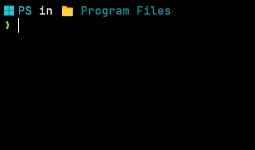

# Spaceship EQ — Oh My Posh theme

A personal Oh My Posh theme for PowerShell, with operating system, current folder, Python environment, and Git information on the first line, followed by a minimal prompt on a second line.

This is a customized version of the original [Spaceship theme](https://github.com/JanDeDobbeleer/oh-my-posh/blob/main/themes/spaceship.omp.json) from [Oh My Posh](https://ohmyposh.dev/).

## Preview



Example appearance after installation. Python and Git segments appear when their respective context is available.

## Install on Windows

### 1. Install the prerequisites

Use PowerShell 7, Git, and Oh My Posh. If needed, install them with Windows Package Manager:

```powershell
winget install --id Microsoft.PowerShell --exact --source winget
winget install --id Git.Git --exact --source winget
winget install --id JanDeDobbeleer.OhMyPosh --exact --source winget
```

Open a new PowerShell 7 session (`pwsh`) after installation so the updated PATH is available.

Install a [Nerd Font](https://www.nerdfonts.com/font-downloads) and select it as the font for your PowerShell profile in your terminal's settings. The theme uses Nerd Font glyphs for Python and Git; without a compatible font, these may appear as boxes.

### 2. Download the theme

Clone the repository to a stable location:

```powershell
$repositoryUrl = 'https://github.com/equalium/oh-my-posh-equalium.git'
git clone $repositoryUrl "$HOME\oh-my-posh-equalium"
```

If you already have a local copy, skip cloning and use its actual location in the next step.

Keep the theme outside Oh My Posh's installation directory so application updates do not overwrite your customization.

### 3. Configure your PowerShell profile

Create your profile only if it does not already exist, then open it:

```powershell
if (-not (Test-Path -LiteralPath $PROFILE)) {
    New-Item -ItemType File -Path $PROFILE -Force | Out-Null
}
notepad $PROFILE
```

Add the following line, or replace your existing `oh-my-posh init` line. Keep only one Oh My Posh initialization command and preserve your other profile settings.

```powershell
oh-my-posh init pwsh --config "$HOME\oh-my-posh-equalium\spaceship-eq.omp.json" | Invoke-Expression
```

If you saved the repository somewhere else, replace the configuration path with that location. For example:

```powershell
oh-my-posh init pwsh --config "C:\Themes\oh-my-posh-equalium\spaceship-eq.omp.json" | Invoke-Expression
```

Save the profile and reload it:

```powershell
. $PROFILE
```

## Verify the setup

```powershell
oh-my-posh version
Test-Path "$HOME\oh-my-posh-equalium\spaceship-eq.omp.json"
```

Adjust the verification path if you chose another location. The path check should return `True`, and the prompt should use two lines. Python and Git segments appear when their respective context is available.

If PowerShell blocks profile execution, inspect `Get-ExecutionPolicy -List` and follow your computer's security policy; do not bypass organization-managed restrictions. If icons are missing, check your terminal's selected Nerd Font.

## Update the theme

Download future changes with:

```powershell
git -C "$HOME\oh-my-posh-equalium" pull --ff-only
. $PROFILE
```

Adjust the path to match your installation. Commit or otherwise preserve local theme edits before updating; do not discard them to force an update.

## References

- [Oh My Posh Windows installation](https://ohmyposh.dev/docs/installation/windows)
- [PowerShell prompt setup](https://ohmyposh.dev/docs/installation/prompt)
- [Fonts](https://ohmyposh.dev/docs/installation/fonts)

## Attribution

Based on the original [Spaceship theme](https://github.com/JanDeDobbeleer/oh-my-posh/blob/main/themes/spaceship.omp.json) from [Oh My Posh by Jan De Dobbeleer and contributors](https://github.com/JanDeDobbeleer/oh-my-posh). This repository contains a personal modification, not the original theme.

See the [upstream license](https://github.com/JanDeDobbeleer/oh-my-posh/blob/main/LICENSE) for the original project's terms. This repository does not yet declare a separate license.
